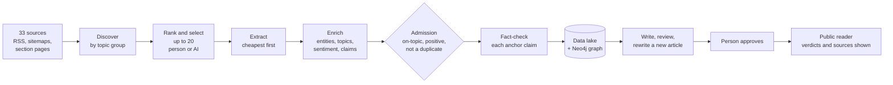

# Inspiring News

[](https://github.com/aespinoza-napp/inspiring-news/actions/workflows/check.yml)
[](LICENSE)

**An AI newsroom that finds constructive news, fact-checks every claim
against the open web, and writes new articles from the verified sources.
It is built so that the evidence behind each verdict is always shown, and
it is measured against people at every step where a person makes the same
decision.**

Built by Adria Espinoza as a Master's thesis in Data Science (FIB,
Universitat Politècnica de Catalunya), 2026. The pipeline is the
artefact; the evaluation is the contribution.

---

## At a glance

| | |
|---|---|
| **What it does** | Reads 33 news sources in English and Spanish (37 configured; four only rate evidence), picks the stories worth publishing on chosen topics, checks the claims each one rests on against live web evidence, and writes, reviews and publishes new articles in Catalan, Spanish or English, with a person approving every one |
| **How it decides** | A cautious pipeline: no evidence, or a verdict that cites none, is forced to `UNVERIFIED`; a source that does not address the claim is cut before the model sees it; every verdict names its sources and quotes them |
| **How it is measured** | A hand-built validation set of 139 facts with a frozen train/test split, a resumable evaluation harness with bootstrap confidence intervals, run-to-run consistency, an oracle-evidence condition, and response time for every stage |
| **Engineering** | Python/FastAPI back end, a separate model server, Next.js front end, Docker Compose for development and production, Terraform for Google Cloud. 1,800+ automated tests and CI on every push |
| **Status** | Built end to end and measured on its own data. Thesis due December 2026 |

## How it works



**Fact-checking one claim**, the core of the project:

1. **Three web queries, not one**: who and what, what is asserted, and a
   search for refutations, fused by reciprocal rank with matches from the
   system's own article corpus (SearXNG and Qdrant).
2. **A funnel**: at most eight pages read, ranked by embedding similarity,
   shared terms, recency and the source's reliability. A **pertinence gate**
   cuts any source that does not address the claim.
3. **A verdict from a language model** (`TRUE`, `PARTIALLY_TRUE`,
   `MISLEADING`, `FALSE`, `UNVERIFIED`), citing sources by number with a
   stance and a quote for each. A quote that is not in the source is
   dropped.
4. **Confidence recalibration**, the guardrail against a small model
   bluffing: no evidence, or a definitive verdict resting on no cited
   source, becomes `UNVERIFIED`, with the model's own answer kept beside it.

**Writing**, after an article is verified: related coverage is gathered,
a draft is written in a closed world (only the numbered sources, a
citation on every factual sentence, no claim the fact-checks rejected),
reviewed on nine metrics checked against the sources, rewritten towards
targets, and published only after a person approves it, with the AI's
part disclosed on the page.

## What has been measured

On the custom validation set (139 facts: 109 natural claims and 30
synthetic false ones made by changing one figure, date, name or relation
of a true claim), split 50/50 by article and frozen before any run:

| Result | Value |
|---|---|
| Verifier accuracy, test half (70 claims) | 52.9% [41.4, 64.3] |
| Agreement with gold on the 55 natural claims | Cohen's κ −0.013: the small verifier is no better than chance there |
| Synthetic false claims caught | 12 of 15 |
| Same claims run twice, hours apart | 13 of 14 verdicts the same (κ 0.84); on the whole train half, 87% (κ 0.76) |
| What better retrieval could add | +10.1 points [−2.9, +24.6] with the annotator's own evidence pages (train half) |
| A claim's response time, CPU only | 73 s at the median, three quarters of it the language model |

Three models were compared for each role, with a decision rule written
before any result: `llama3.2:3b` stays the fact-checker, since a newer
4B model read the same evidence 20 points worse. A 9B model was as
accurate and far more careful, at three times the time. `qwen3.5:4b`
writes; `qwen3.5:9b` reviews, finding all ten planted defects in test
drafts against five for the 3B.

These numbers are reported as they came out, intervals included. 108 of
the 139 gold labels were proposed by an AI and are being checked by hand,
so every figure is provisional until that review is done. The full
method and results are in [`docs/decisions/evaluation.md`](docs/decisions/evaluation.md).

## Engineering highlights

- **Models in their own service.** Entity extraction (GLiNER), sentiment
  (XLM-RoBERTa) and embeddings (bge-m3) run in `inference/`, reached over
  HTTP, so the API container stays small. An invariant test fails the build
  if the back end imports a model library again.
- **Reproducible evaluation.** Every run is keyed by its dataset hash, model,
  thresholds, weights and harness version, and records the commit it ran on. It writes one fsynced line per
  claim, so a crash resumes where it stopped. Every metric carries a seeded
  bootstrap interval, and paired comparisons are tested to give exactly zero
  for a run against itself.
- **Per-run thresholds, never frozen at import.** Every tunable can be
  overridden for one request. A test suite of invariants enforces the rules
  that broke once, each with the incident behind it written down.
- **Concurrency without wrong answers.** Claims are checked in parallel
  under per-service ceilings, and results always come back in input order,
  because the model cites evidence by number.
- **Security.** An SSRF guard on every server-side fetch, an API key on
  every endpoint but the public reader, health checks and job polling,
  and, in the production configuration, Caddy with HTTPS and a password
  in front of the site.
- **Observability and deployment.** `/healthz` and Prometheus `/metrics`,
  a job journal that survives restarts, and production compose files with
  memory caps. One language model in memory at a time, swapped on demand,
  so three roles fit a 16 GB machine. Terraform for Google Cloud is checked
  against a local emulator; it has not yet been applied to a real project.
- **Decisions recorded.** Each subsystem has a record of why it is built
  the way it is, in [`docs/decisions/`](docs/decisions/).

## Tech stack

| Area | Tools |
|---|---|
| Back end | Python 3.12, FastAPI, Pydantic, uv |
| NLP and models | GLiNER, XLM-RoBERTa sentiment, BAAI bge-m3 embeddings, yake; LLMs via Ollama (llama3.2, Qwen3.5) or any OpenAI-compatible endpoint |
| Retrieval and storage | SearXNG metasearch, Qdrant vector store, Neo4j graph, a three-layer JSON data lake |
| Scraping | Trafilatura, BeautifulSoup, Playwright (Chromium) as the last resort |
| Front end | Next.js 14 (App Router), TypeScript, hand-written CSS, no UI library |
| Infrastructure | Docker Compose (development, production, Google Cloud layer), Terraform, Caddy, GitHub Actions |
| Evaluation | A custom harness: bootstrap intervals, Cohen's κ, paired comparisons, stage attribution |

## Repository map

| Path | What is there |
|---|---|
| [`backend/`](backend/) | The pipeline, the job API, storage, the evaluation harness (`src/evaluation/`) |
| [`inference/`](inference/) | The model server: entities, sentiment, embeddings |
| [`frontend/`](frontend/) | The newsroom (Discover, Analyze, Live, Write, Reader) and the lab tools per stage |
| [`labeller/`](labeller/) | A dependency-free app for hand-labelling the validation set |
| [`docker/`](docker/), [`deploy/gcp/`](deploy/gcp/) | Compose stacks and the Google Cloud Terraform |
| [`scripts/`](scripts/) | `check.sh` (the definition of done), `stack.sh` (what to run per activity), model trials |
| [`docs/decisions/`](docs/decisions/) | Why each part is the way it is |
| [`docs/roadmap.md`](docs/roadmap.md) | The plan and its verified status, task by task |
| [`docs/final_document/`](docs/final_document/) | The thesis (LaTeX and PDF) |

## Running it

Copy the example settings. Every value is a working default but the
secrets:

```bash
cp backend/.env-example backend/.env          # then fill SEARXNG_SECRET and change NEO4J_PASSWORD
cp frontend/.env.local.example frontend/.env.local
```

The quickest way in is Docker, with Ollama on the host
(`ollama pull llama3.2:3b`):

```bash
./scripts/stack.sh analyse    # SearXNG, inference, Neo4j and the API, one model loaded
cd frontend && npm install && npm run dev      # http://localhost:3000
```

The API documentation is at `http://localhost:8000/docs`, and
`/healthz` says which dependency is down. To run the pieces without
Docker, see [`backend/CLAUDE.md`](backend/CLAUDE.md) and
[`docker/README.md`](docker/README.md).

```bash
./scripts/check.sh            # every test suite and the frontend typecheck
./scripts/check.sh fast       # the invariants only, in seconds
```

## Status and what is next

Built and working: discovery and selection, the fact-checking pipeline,
the graph, the writing and publishing flow, the public reader, the
evaluation harness, and the production configuration. In progress until
December 2026:

- the hand review of the AI-proposed labels, and a blind re-label of a
  fifth of the test half for annotator consistency;
- the test half under three evidence conditions (none, retrieved, the
  annotator's own pages);
- the reader in Catalan and Spanish, and a usability check with readers;
- the thesis.

The task-by-task status, with what is verified and what is not, is in
[`docs/roadmap.md`](docs/roadmap.md).

## License

[Apache 2.0](LICENSE).
